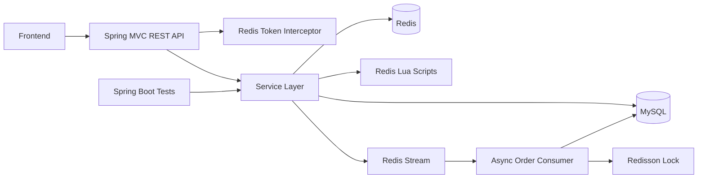

# Local Commerce Service

English | [简体中文](README.zh-CN.md)

A Spring Boot backend for a nearby lifestyle and local-commerce platform. The service covers merchant discovery, vouchers and flash sales, restaurant reviews, social following, user sign-in, and profile-related APIs.

## Repository Strategy

This project uses a **monorepo**. The frontend and backend belong to the same GitHub repository:

```text
nearby-commerce/
|-- local-commerce-service/   # Spring Boot backend
|-- frontend/                 # Frontend source code
|-- README.md                 # English documentation
`-- README.zh-CN.md           # Chinese documentation
```

Place the frontend source in `frontend/` and commit it to this repository. Do not create a second GitHub repository unless the frontend and backend are owned by separate teams or must be released and versioned independently. The frontend is a static Vue 2 web client stored in `frontend/`; see [frontend/README.md](frontend/README.md) for its structure and deployment instructions.

## Table of Contents

- [Project Overview](#project-overview)
- [Core Features](#core-features)
- [Architecture](#architecture)
- [Technology Stack](#technology-stack)
- [Key Implementation Details](#key-implementation-details)
- [API Overview](#api-overview)
- [Data Model](#data-model)
- [Local Development](#local-development)
- [Configuration](#configuration)
- [Current Status and Limitations](#current-status-and-limitations)
- [Git and GitHub Workflow](#git-and-github-workflow)

## Project Overview

The backend provides a REST API for a local lifestyle application. Users can browse nearby merchants, view merchant details and vouchers, publish reviews, follow other users, receive a following feed, sign in daily, and participate in voucher flash sales.

The implementation focuses on:

- Redis-backed caching and high-concurrency flash-sale processing.
- Geospatial merchant search with Redis GEO.
- Social feeds, likes, follows, and common-follow queries with Redis data structures.
- Stateless API authentication with Redis-backed tokens.
- A layered Spring Boot architecture using controllers, services, MyBatis-Plus mappers, entities, and DTOs.

## Core Features

### Authentication and User Profile

- Send a six-digit phone verification code and store it in Redis with a short TTL.
- Log in with a phone number and verification code.
- Create a new user automatically when the phone number is not registered.
- Return a UUID token and store the current user as a Redis hash.
- Read the current user from the `authorization` request header on subsequent requests.
- Refresh the Redis token TTL on authenticated requests.
- Query basic user information and extended user profile information.
- Support monthly sign-in and consecutive sign-in counting with a Redis Bitmap.

### Merchant Discovery

- List merchant categories.
- Query merchant details with Redis caching.
- Search merchants by name with pagination.
- Query merchants by category.
- Query nearby merchants by category and coordinates.
- Use Redis GEO to search within a 5 km radius, sort by distance, paginate the result, and attach the distance to each merchant.
- Update merchant data and invalidate the related cache entry.

### Vouchers and Flash Sales

- List vouchers belonging to a merchant.
- Create regular vouchers and flash-sale vouchers.
- Validate stock and duplicate orders atomically in a Redis Lua script.
- Generate distributed order IDs with Redis `INCR` and a timestamp-based bit layout.
- Publish successful flash-sale requests to a Redis Stream.
- Consume stream messages asynchronously and create database orders.
- Use Lua atomic checks during request acceptance and a Redisson lock during order persistence to prevent duplicate submissions.
- Use a transactional database update with `stock > 0` as a final stock guard.

### Restaurant Reviews and Social Features

- Publish review notes with images, text, and merchant association.
- Query hot notes, a user's own notes, and another user's notes.
- View note details with author information and current-user like status.
- Like and unlike notes.
- Store note likes in a Redis sorted set and query the first five users who liked a note.
- Follow and unfollow users.
- Check whether the current user follows another user.
- Query common follows with Redis set intersection.
- Push new notes into each follower's Redis sorted-set inbox.
- Read the following feed with score-based scrolling and offset handling.

### Image Upload

- Upload review images to a local directory.
- Generate a UUID-based file name and sharded directory structure.
- Provide an image deletion endpoint.

### API Conventions

- REST-style JSON endpoints under `/shop`, `/shop-type`, `/voucher`, `/voucher-order`, `/blog`, `/follow`, `/user`, and `/upload`.
- A common response envelope with `success`, `errorMsg`, `data`, and `total`.
- Public access is allowed for merchant, category, voucher listing, hot notes, login, verification code, and upload routes.
- Other routes require a valid token in the `authorization` header.
- Runtime exceptions are converted to a generic JSON error by `WebExceptionAdvice`.

## Architecture



The backend is organized by responsibility:

```text
local-commerce-service/
|-- src/main/java/com/localcommerce/
|   |-- config/       # MVC, MyBatis-Plus, Redis Stream, Redisson, exception handling
|   |-- controller/   # REST endpoints
|   |-- dto/          # API request and response objects
|   |-- entity/       # Database entities
|   |-- mapper/       # MyBatis-Plus mappers
|   |-- service/      # Service interfaces and implementations
|   `-- utils/        # Tokens, Redis locks, cache client, ID worker, regex helpers
|-- src/main/resources/
|   |-- db/           # Schema and seed SQL
|   |-- mapper/       # Custom MyBatis XML
|   |-- seckill.lua   # Atomic flash-sale script
|   |-- unlock.lua    # Safe Redis lock release script
|   `-- application.yaml
`-- src/test/         # Spring Boot integration and Redis data-structure experiments
```

## Technology Stack

### Backend

| Area | Technology | Version or Notes |
| --- | --- | --- |
| Language | Java | 8 |
| Framework | Spring Boot | 2.3.12.RELEASE |
| Web layer | Spring MVC | Provided by Spring Boot |
| Persistence | MyBatis-Plus | 3.4.3 |
| Database | MySQL | Connector 5.1.47 |
| Cache and data structures | Spring Data Redis | 2.6.2 |
| Redis client | Lettuce | 6.1.6.RELEASE |
| Distributed locks | Redisson | 3.13.6 |
| Atomic operations | Lua | `seckill.lua`, `unlock.lua` |
| Utilities | Hutool | 5.7.17 |
| Boilerplate reduction | Lombok | Managed by Spring Boot |
| AOP | Spring AOP and AspectJ Weaver | Used for transactional proxy exposure |
| Build | Maven | `pom.xml` |
| Testing | Spring Boot Test and JUnit 5 | Integration-style tests |

### Frontend

The frontend is a mobile-oriented static multi-page application under `frontend/`.

| Area | Technology | Notes |
| --- | --- | --- |
| Markup | HTML5 | Separate pages for home, merchant list, merchant details, reviews, login, and profile |
| Styling | CSS3 | Page-specific styles plus shared components and custom themes |
| UI framework | Vue 2 | Loaded locally from `js/vue.js` |
| Component library | Element UI 2.15.3 | Loaded locally from `js/element.js` |
| HTTP client | Axios | Loaded locally from `js/axios.min.js` |
| API proxy | Nginx | `/api` is rewritten to the Spring Boot backend |
| Build tooling | None | The frontend is served directly as static files |

The current frontend does not use a package manager or bundler. Vue, Element UI, and Axios are vendored into the repository so the site can run without an npm install step.

## Key Implementation Details

### Caching

- Merchant details use a cache-aside flow.
- Logical expiration keeps data available while a background thread rebuilds an expired cache entry.
- A Redis lock prevents multiple concurrent cache rebuilds.
- Null caching reduces database pressure caused by repeated requests for non-existent merchants.
- Merchant updates delete the corresponding cache key.

### Authentication

- The client sends the token through the `authorization` header.
- User data is stored in Redis under `login:token:{token}`.
- A refresh interceptor loads the user into a `ThreadLocal` context and extends the token TTL.
- A login interceptor rejects protected requests when no authenticated user is present.
- The current token TTL constant is `36,000` minutes. This is a sliding expiration, not a fixed session duration.

### Nearby Merchant Search

- Merchant coordinates are stored in Redis GEO keys in the form `shop:geo:{typeId}`.
- A query uses the supplied longitude and latitude as the center.
- The default radius is 5 km.
- Results are sorted by distance before pagination.
- MySQL is used to retrieve full merchant records while preserving the Redis distance order.

### Flash-Sale Processing

1. The client calls `POST /voucher-order/seckill/{voucherId}`.
2. A timestamp-based order ID is generated with Redis.
3. `seckill.lua` checks stock and duplicate submissions atomically.
4. The script decrements stock, records the user in a Redis set, and appends an order message to `stream.orders`.
5. A Spring `StreamMessageListenerContainer` consumes the message asynchronously.
6. A Redisson lock protects order creation for each user.
7. A transactional service rechecks duplicates, decrements MySQL stock with `stock > 0`, and inserts the order.

### Social Feed

- Publishing a note writes the note to MySQL.
- The note ID is inserted into every follower's Redis sorted set using the publish timestamp as the score.
- The feed endpoint reads in reverse score order and uses `minTime` plus `offset` to support stable scrolling.

## API Overview

Authentication is required unless the endpoint is listed as public. Public routes are configured in `MvcConfig`.

### User and Authentication

| Method | Endpoint | Access | Description |
| --- | --- | --- | --- |
| POST | `/user/code?phone=...` | Public | Send and store a verification code |
| POST | `/user/login` | Public | Log in with phone and code |
| POST | `/user/logout` | Authenticated | Placeholder endpoint, not implemented |
| GET | `/user/me` | Authenticated | Get the current user |
| GET | `/user/{id}` | Authenticated | Get basic user data |
| GET | `/user/info/{id}` | Authenticated | Get extended user profile |
| POST | `/user/sign` | Authenticated | Sign in for the current day |
| GET | `/user/sign/count` | Authenticated | Count consecutive sign-in days |

### Merchants

| Method | Endpoint | Access | Description |
| --- | --- | --- | --- |
| GET | `/shop/{id}` | Public | Get merchant details |
| GET | `/shop/of/name?name=...&current=1` | Public | Search merchants by name |
| GET | `/shop/of/type?typeId=1&current=1&x=...&y=...` | Public | Search by category and optional coordinates |
| POST | `/shop` | Public | Create a merchant |
| PUT | `/shop` | Public | Update a merchant and invalidate its cache |
| GET | `/shop-type/list` | Public | List merchant categories |

### Vouchers and Orders

| Method | Endpoint | Access | Description |
| --- | --- | --- | --- |
| GET | `/voucher/list/{shopId}` | Public | List vouchers for a merchant |
| POST | `/voucher` | Public | Create a regular voucher |
| POST | `/voucher/seckill` | Public | Create a flash-sale voucher |
| POST | `/voucher-order/seckill/{voucherId}` | Authenticated | Join a flash sale |

### Reviews and Social

| Method | Endpoint | Access | Description |
| --- | --- | --- | --- |
| POST | `/blog` | Authenticated | Publish a review note |
| GET | `/blog/hot?current=1` | Public | List hot notes |
| GET | `/blog/of/me?current=1` | Authenticated | List the current user's notes |
| GET | `/blog/of/user?id=...&current=1` | Authenticated | List another user's notes |
| GET | `/blog/{id}` | Authenticated | Get note details |
| GET | `/blog/of/follow?lastId=...&offset=...` | Authenticated | Read the following feed |
| PUT | `/blog/like/{id}` | Authenticated | Like or unlike a note |
| GET | `/blog/likes/{id}` | Authenticated | List the first five users who liked a note |
| PUT | `/follow/{id}/{isFollow}` | Authenticated | Follow or unfollow a user |
| GET | `/follow/or/not/{id}` | Authenticated | Check follow status |
| GET | `/follow/common/{id}` | Authenticated | List common follows |

### Upload

| Method | Endpoint | Access | Description |
| --- | --- | --- | --- |
| POST | `/upload/blog` | Public | Upload a review image as multipart form data |
| GET | `/upload/blog/delete?name=...` | Public | Delete an uploaded image |

## Data Model

| Table | Purpose |
| --- | --- |
| `tb_shop` | Merchant profile, category, location, rating, and business information |
| `tb_shop_type` | Merchant categories and display order |
| `tb_voucher` | Voucher metadata |
| `tb_seckill_voucher` | Flash-sale stock and time window |
| `tb_voucher_order` | Voucher orders |
| `tb_user` | User account and login data |
| `tb_user_info` | Extended user profile |
| `tb_blog` | Review notes |
| `tb_blog_comments` | Comment table, schema present but API not implemented |
| `tb_follow` | Following relationships |
| `tb_sign` | Traditional sign-in table, while the current sign-in flow uses Redis Bitmap |

Relationship summary:

- A merchant belongs to one merchant category.
- A voucher belongs to one merchant and may have one flash-sale record.
- A flash-sale order belongs to one user and one voucher.
- A review note belongs to one user and one merchant.
- A follow record links a user to another user.

## Local Development

### Prerequisites

- JDK 8
- Maven 3.6 or later
- MySQL 5.7 or later
- Redis 5 or later

The project targets Java 8. Building with JDK 21 is not supported by the pinned Lombok and compiler versions and can fail with a `JCTree$JCImport` error. Use JDK 8 for a compatible build.

### 1. Initialize MySQL

Import the main schema and sample data first:

```bash
mysql -u root -p < local-commerce-service/src/main/resources/db/local_commerce.sql
```

Additional seed scripts can be imported as needed:

```text
local_commerce_shop_seed.sql
local_commerce_hangzhou_seed.sql
local_commerce_content_seed.sql
local_commerce_imported_notes_seed.sql
local_commerce_imported_notes_rollback.sql
```

Review the seed data before publishing the repository. It contains sample user and phone-number records.

### 2. Configure Environment Variables

PowerShell:

```powershell
$env:MYSQL_PASSWORD = "your-local-mysql-password"
$env:REDIS_PASSWORD = "your-local-redis-password"
$env:MYSQL_USERNAME = "root"
$env:REDIS_HOST = "127.0.0.1"
$env:REDIS_PORT = "6379"
```

Bash:

```bash
export MYSQL_PASSWORD="your-local-mysql-password"
export REDIS_PASSWORD="your-local-redis-password"
export MYSQL_USERNAME="root"
export REDIS_HOST="127.0.0.1"
export REDIS_PORT="6379"
```

Leave `REDIS_PASSWORD` empty when the local Redis instance has no password.

### 3. Build and Run

```bash
cd local-commerce-service
mvn -DskipTests package
mvn spring-boot:run
```

The default API base URL is `http://localhost:8081`.

The frontend is served separately as static files. The recommended development setup is Nginx on port `8080` with `/api` proxied to the backend. The current API base path is configured in `frontend/js/common.js`, and a working Nginx example is documented in [frontend/README.md](frontend/README.md).

### 4. Tests

```bash
cd local-commerce-service
mvn test
```

The existing tests are Spring Boot integration-style tests and include Redis ID generation, cache writes, GEO indexing, and HyperLogLog experiments. They require a working MySQL and Redis environment. They are not yet a complete functional regression suite.

## Configuration

The main configuration is `local-commerce-service/src/main/resources/application.yaml`.

| Variable | Default | Purpose |
| --- | --- | --- |
| `SERVER_PORT` | `8081` | Backend HTTP port |
| `MYSQL_URL` | `jdbc:mysql://127.0.0.1:3306/local_commerce?useSSL=false&serverTimezone=UTC` | JDBC URL |
| `MYSQL_USERNAME` | `root` | MySQL username |
| `MYSQL_PASSWORD` | Empty | MySQL password |
| `REDIS_HOST` | `127.0.0.1` | Redis host used by Spring Data Redis and Redisson |
| `REDIS_PORT` | `6379` | Redis port used by Spring Data Redis and Redisson |
| `REDIS_PASSWORD` | Empty | Redis password used by Spring Data Redis and Redisson |

Important files:

- `application.yaml`: datasource, Redis, server, Jackson, and logging configuration.
- `RedisStreamConfig.java`: Redis Stream listener container.
- `RedissonConfig.java`: Redisson client, using the same Redis host, port, and password properties.
- `MvcConfig.java`: authentication interceptors and public routes.
- `SystemConstants.java`: page sizes and the current local image upload directory.

## Current Status and Limitations

- The frontend is a static Vue 2 application without a bundler, package manifest, lint configuration, or automated UI test suite.
- The comment database entity and table exist, but `BlogCommentsController` has no implemented endpoints.
- `POST /user/logout` is a placeholder and needs a real token invalidation implementation.
- SMS delivery is not integrated. The verification code is generated and logged by the backend.
- Image upload uses local filesystem storage and the upload directory is currently defined in `SystemConstants`. Object storage and external configuration should be added before production deployment.
- The image deletion endpoint uses `GET` and should be moved behind an authenticated `DELETE` route before production use.
- Some controller routes such as merchant creation and update are currently public. Add role-based authorization before exposing administrative operations.
- The seed SQL contains sample users and phone numbers. Replace or anonymize them if they are not synthetic.
- No Docker, CI/CD, API documentation generator, or production deployment configuration is included.
- The existing tests are development and integration checks, not a complete automated regression suite.

## Git and GitHub Workflow

This repository has been initialized on the `main` branch. Create an empty GitHub repository, then connect it:

```bash
git remote add origin https://github.com/<your-account>/<repository>.git
git push -u origin main
```

After adding the frontend source:

```bash
git add frontend
git commit -m "feat: add frontend"
git push
```

Do not commit `node_modules`, frontend build output, logs, IDE files, local environment files, private keys, tokens, or database credentials. The root `.gitignore` already covers the common cases.
