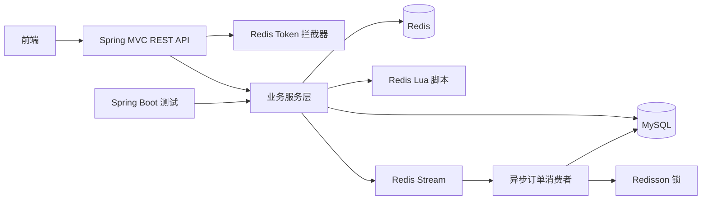

# 近场消费服务

[English](README.md) | 简体中文

这是一个面向本地生活与近场消费场景的 Spring Boot 后端项目。服务覆盖商户发现、优惠券与秒杀、探店笔记、用户关注、签到和个人资料等核心能力。

## 仓库策略

本项目采用 **前后端双仓库** 方式管理代码，后端和前端分别进行版本管理和部署：

```text
nearfield-commerce-platform/  # 当前仓库
|-- local-commerce-service/   # Spring Boot 后端
|-- README.md
`-- README.zh-CN.md

nearfield-commerce-web/       # 独立前端仓库
|-- index.html
|-- css/
|-- imgs/
`-- js/
```

前端源码使用独立仓库管理，并部署在 Nginx 的 `html/local-commerce` 目录中。Nginx 负责托管静态前端，并将 `/api` 代理到当前后端。当前后端仓库不再包含前端文件。

## 目录

- [项目简介](#项目简介)
- [核心功能](#核心功能)
- [系统架构](#系统架构)
- [技术栈](#技术栈)
- [关键技术实现](#关键技术实现)
- [API 概览](#api-概览)
- [数据模型](#数据模型)
- [本地运行](#本地运行)
- [配置说明](#配置说明)
- [当前状态与限制](#当前状态与限制)
- [Git 与 GitHub 工作流](#git-与-github-工作流)

## 项目简介

该后端为本地生活类应用提供 REST API。用户可以浏览附近商户、查看商户和优惠券、发布探店笔记、关注其他用户、查看关注流、每日签到以及参与优惠券秒杀。

项目重点实现了以下能力：

- 基于 Redis 的缓存和高并发秒杀处理。
- 基于 Redis GEO 的附近商户搜索。
- 基于 Redis 数据结构的社会化信息流、点赞、关注和共同关注。
- 基于 Redis Token 的无状态 API 鉴权。
- 基于 Spring Boot 分层架构的控制器、服务、MyBatis-Plus Mapper、实体和 DTO。

## 核心功能

### 登录与用户资料

- 发送六位手机验证码，并按较短 TTL 保存到 Redis。
- 使用手机号和验证码登录。
- 手机号未注册时自动创建新用户。
- 登录成功后生成 UUID Token，并将当前用户信息保存为 Redis Hash。
- 后续请求通过 `authorization` 请求头读取当前用户。
- 用户访问受保护接口时自动刷新 Token 有效期。
- 查询用户基本信息和扩展资料。
- 使用 Redis Bitmap 实现月度签到和连续签到天数统计。

### 商户发现

- 查询商户分类列表。
- 根据 ID 查询商户详情，并使用 Redis 缓存。
- 按名称分页搜索商户。
- 按分类分页查询商户。
- 按分类和经纬度查询附近商户。
- 使用 Redis GEO 搜索 5 km 范围内的商户，按距离排序、分页，并将距离回填到结果中。
- 更新商户信息并删除对应缓存。

### 优惠券与秒杀

- 查询指定商户的优惠券列表。
- 创建普通优惠券和秒杀优惠券。
- 使用 Redis Lua 脚本原子校验库存和重复下单。
- 使用 Redis `INCR` 和时间戳位运算生成分布式订单 ID。
- 将秒杀成功的请求写入 Redis Stream。
- 异步消费 Stream 消息并创建数据库订单。
- 请求受理阶段使用 Lua 原子校验，订单落库阶段使用 Redisson 锁，避免重复下单。
- 通过带 `stock > 0` 条件的数据库更新完成最终库存兜底。

### 探店笔记与社交

- 发布包含图片、文字和商户关联信息的探店笔记。
- 查询热门笔记、我的笔记和其他用户的笔记。
- 查看笔记详情，并附带作者信息和当前用户点赞状态。
- 点赞和取消点赞。
- 使用 Redis ZSet 保存点赞用户，并按点赞顺序查询前五名用户。
- 关注和取关其他用户。
- 判断当前用户是否关注指定用户。
- 使用 Redis Set 交集查询共同关注。
- 发布笔记时将笔记推送到每个粉丝的 Redis ZSet 收件箱。
- 使用时间和偏移量实现关注流的滚动分页。

### 图片上传

- 将探店图片上传到本地目录。
- 使用 UUID 文件名和分片目录减少单目录文件数量。
- 提供图片删除接口。

### API 约定

- REST 风格 JSON 接口主要位于 `/shop`、`/shop-type`、`/voucher`、`/voucher-order`、`/blog`、`/follow`、`/user` 和 `/upload`。
- 统一响应体包含 `success`、`errorMsg`、`data` 和 `total`。
- 商户、分类、优惠券列表、热门笔记、登录、验证码和上传接口允许匿名访问。
- 其他接口需要通过 `authorization` 请求头携带有效 Token。
- 运行时异常由 `WebExceptionAdvice` 统一转换为 JSON 错误响应。

## 系统架构



后端按职责划分：

```text
local-commerce-service/
|-- src/main/java/com/localcommerce/
|   |-- config/       # MVC、MyBatis-Plus、Redis Stream、Redisson、异常处理
|   |-- controller/   # REST 接口
|   |-- dto/          # 请求与响应对象
|   |-- entity/       # 数据库实体
|   |-- mapper/       # MyBatis-Plus Mapper
|   |-- service/      # 服务接口与实现
|   `-- utils/        # Token、Redis 锁、缓存客户端、ID 生成器、正则工具
|-- src/main/resources/
|   |-- db/           # 建表与种子 SQL
|   |-- mapper/       # 自定义 MyBatis XML
|   |-- seckill.lua   # 原子秒杀脚本
|   |-- unlock.lua    # 安全释放 Redis 锁脚本
|   `-- application.yaml
`-- src/test/         # Spring Boot 集成测试和 Redis 数据结构实验
```

## 技术栈

### 后端

| 领域 | 技术 | 版本或说明 |
| --- | --- | --- |
| 开发语言 | Java | 8 |
| 应用框架 | Spring Boot | 2.3.12.RELEASE |
| Web 层 | Spring MVC | 由 Spring Boot 提供 |
| 持久层 | MyBatis-Plus | 3.4.3 |
| 数据库 | MySQL | Connector 5.1.47 |
| 缓存与数据结构 | Spring Data Redis | 2.6.2 |
| Redis 客户端 | Lettuce | 6.1.6.RELEASE |
| 分布式锁 | Redisson | 3.13.6 |
| 原子操作 | Lua | `seckill.lua`、`unlock.lua` |
| 工具库 | Hutool | 5.7.17 |
| 简化样板代码 | Lombok | 由 Spring Boot 管理 |
| AOP | Spring AOP、AspectJ Weaver | 用于暴露事务代理 |
| 构建工具 | Maven | `pom.xml` |
| 测试 | Spring Boot Test、JUnit 5 | 集成式测试 |

### 前端

前端使用独立仓库管理，是一个面向移动端展示的静态多页应用，部署在 Nginx 目录中。

| 领域 | 技术 | 说明 |
| --- | --- | --- |
| 页面结构 | HTML5 | 首页、商户列表、商户详情、探店笔记、登录和个人中心分别使用独立页面 |
| 样式 | CSS3 | 页面样式、公共组件样式和定制主题 |
| 前端框架 | Vue 2 | 从 `js/vue.js` 本地加载 |
| UI 组件库 | Element UI 2.15.3 | 从 `js/element.js` 本地加载 |
| HTTP 客户端 | Axios | 从 `js/axios.min.js` 本地加载 |
| API 代理 | Nginx | 将 `/api` 重写并代理到 Spring Boot 后端 |
| 构建工具 | 无 | 前端作为静态文件直接部署 |

当前前端不使用 npm 包管理器或打包器。Vue、Element UI 和 Axios 已作为静态依赖放入仓库，因此运行时不需要先执行 `npm install`。

## 关键技术实现

### 缓存

- 商户详情采用 Cache Aside 流程。
- 使用逻辑过期时间，缓存过期后仍可先返回旧数据，再由后台线程重建。
- 使用 Redis 锁避免多个线程同时重建同一份缓存。
- 使用空值缓存降低不存在商户被反复查询数据库的压力。
- 商户更新后删除对应缓存 Key。

### 鉴权

- 客户端通过 `authorization` 请求头传递 Token。
- 用户信息存储在 Redis 的 `login:token:{token}` 中。
- Refresh 拦截器加载用户到 `ThreadLocal`，并延长 Token TTL。
- Login 拦截器在未认证时拒绝受保护请求。
- 当前 Token TTL 常量为 `36,000` 分钟，属于滑动过期，不是固定会话时长。

### 附近商户搜索

- 商户坐标存储在 `shop:geo:{typeId}` 形式的 Redis GEO Key 中。
- 查询时将客户端传入的经纬度作为圆心。
- 默认搜索半径为 5 km。
- 结果先按距离排序，再进行分页。
- 从 MySQL 查询完整商户信息，并保持 Redis 返回的距离顺序。

### 秒杀处理

1. 客户端调用 `POST /voucher-order/seckill/{voucherId}`。
2. 使用 Redis 生成带时间戳的订单 ID。
3. `seckill.lua` 原子校验库存和重复下单。
4. 脚本扣减库存、记录已下单用户，并向 `stream.orders` 追加消息。
5. Spring `StreamMessageListenerContainer` 异步消费消息。
6. 使用 Redisson 锁保护单用户订单创建。
7. 事务服务重新检查重复下单，以 `stock > 0` 条件扣减 MySQL 库存并写入订单。

### 社会化信息流

- 发布笔记时先写入 MySQL。
- 将笔记 ID 以发布时间戳为 score 写入每个粉丝的 Redis ZSet。
- 关注流按 score 倒序读取，并使用 `minTime` 和 `offset` 实现稳定滚动分页。

## API 概览

除标注为公开的接口外，其余接口都需要认证。公开路由在 `MvcConfig` 中配置。

### 用户与鉴权

| 方法 | 接口 | 权限 | 说明 |
| --- | --- | --- | --- |
| POST | `/user/code?phone=...` | 公开 | 发送并缓存验证码 |
| POST | `/user/login` | 公开 | 手机号和验证码登录 |
| POST | `/user/logout` | 需登录 | 占位接口，尚未实现 |
| GET | `/user/me` | 需登录 | 获取当前用户 |
| GET | `/user/{id}` | 需登录 | 获取用户基本信息 |
| GET | `/user/info/{id}` | 需登录 | 获取用户扩展资料 |
| POST | `/user/sign` | 需登录 | 当日签到 |
| GET | `/user/sign/count` | 需登录 | 查询连续签到天数 |

### 商户

| 方法 | 接口 | 权限 | 说明 |
| --- | --- | --- | --- |
| GET | `/shop/{id}` | 公开 | 查询商户详情 |
| GET | `/shop/of/name?name=...&current=1` | 公开 | 按名称搜索商户 |
| GET | `/shop/of/type?typeId=1&current=1&x=...&y=...` | 公开 | 按分类和可选坐标查询商户 |
| POST | `/shop` | 公开 | 新增商户 |
| PUT | `/shop` | 公开 | 更新商户并删除缓存 |
| GET | `/shop-type/list` | 公开 | 查询商户分类 |

### 优惠券与订单

| 方法 | 接口 | 权限 | 说明 |
| --- | --- | --- | --- |
| GET | `/voucher/list/{shopId}` | 公开 | 查询商户优惠券 |
| POST | `/voucher` | 公开 | 新增普通优惠券 |
| POST | `/voucher/seckill` | 公开 | 新增秒杀优惠券 |
| POST | `/voucher-order/seckill/{voucherId}` | 需登录 | 参与秒杀 |

### 笔记与社交

| 方法 | 接口 | 权限 | 说明 |
| --- | --- | --- | --- |
| POST | `/blog` | 需登录 | 发布探店笔记 |
| GET | `/blog/hot?current=1` | 公开 | 查询热门笔记 |
| GET | `/blog/of/me?current=1` | 需登录 | 查询我的笔记 |
| GET | `/blog/of/user?id=...&current=1` | 需登录 | 查询指定用户的笔记 |
| GET | `/blog/{id}` | 需登录 | 查询笔记详情 |
| GET | `/blog/of/follow?lastId=...&offset=...` | 需登录 | 查询关注流 |
| PUT | `/blog/like/{id}` | 需登录 | 点赞或取消点赞 |
| GET | `/blog/likes/{id}` | 需登录 | 查询前五名点赞用户 |
| PUT | `/follow/{id}/{isFollow}` | 需登录 | 关注或取关 |
| GET | `/follow/or/not/{id}` | 需登录 | 查询是否关注 |
| GET | `/follow/common/{id}` | 需登录 | 查询共同关注 |

### 上传

| 方法 | 接口 | 权限 | 说明 |
| --- | --- | --- | --- |
| POST | `/upload/blog` | 公开 | 以 multipart 表单上传探店图片 |
| GET | `/upload/blog/delete?name=...` | 公开 | 删除已上传图片 |

## 数据模型

| 表名 | 用途 |
| --- | --- |
| `tb_shop` | 商户资料、分类、位置、评分和营业信息 |
| `tb_shop_type` | 商户分类和展示顺序 |
| `tb_voucher` | 优惠券元数据 |
| `tb_seckill_voucher` | 秒杀库存和时间窗口 |
| `tb_voucher_order` | 优惠券订单 |
| `tb_user` | 用户账号和登录数据 |
| `tb_user_info` | 用户扩展资料 |
| `tb_blog` | 探店笔记 |
| `tb_blog_comments` | 评论表，已有数据结构但 API 尚未实现 |
| `tb_follow` | 关注关系 |
| `tb_sign` | 传统签到表，当前签到流程实际使用 Redis Bitmap |

主要关系：

- 一个商户属于一个商户分类。
- 一个优惠券属于一个商户，并可能对应一条秒杀记录。
- 一个秒杀订单属于一个用户和一个优惠券。
- 一篇探店笔记属于一个用户和一个商户。
- 一条关注记录关联一个用户和另一个被关注用户。

## 本地运行

### 环境要求

- JDK 8
- Maven 3.6 或更高版本
- MySQL 5.7 或更高版本
- Redis 5 或更高版本

项目以 Java 8 为目标版本。固定版本的 Lombok 和编译插件与 JDK 21 不兼容，使用 JDK 21 构建可能出现 `JCTree$JCImport` 错误。请使用 JDK 8 进行兼容构建。

### 1. 初始化 MySQL

先导入主表结构和示例数据：

```bash
mysql -u root -p < local-commerce-service/src/main/resources/db/local_commerce.sql
```

按需继续导入其他种子脚本：

```text
local_commerce_shop_seed.sql
local_commerce_hangzhou_seed.sql
local_commerce_content_seed.sql
local_commerce_imported_notes_seed.sql
local_commerce_imported_notes_rollback.sql
```

公开仓库前应检查种子数据。当前 SQL 中包含示例用户和手机号记录。

### 2. 配置环境变量

PowerShell：

```powershell
$env:MYSQL_PASSWORD = "你的本地 MySQL 密码"
$env:REDIS_PASSWORD = "你的本地 Redis 密码"
$env:MYSQL_USERNAME = "root"
$env:REDIS_HOST = "127.0.0.1"
$env:REDIS_PORT = "6379"
```

Bash：

```bash
export MYSQL_PASSWORD="你的本地 MySQL 密码"
export REDIS_PASSWORD="你的本地 Redis 密码"
export MYSQL_USERNAME="root"
export REDIS_HOST="127.0.0.1"
export REDIS_PORT="6379"
```

如果本地 Redis 没有密码，`REDIS_PASSWORD` 可以留空。

### 3. 构建与启动

```bash
cd local-commerce-service
mvn -DskipTests package
mvn spring-boot:run
```

默认 API 地址为 `http://localhost:8081`。

前端作为静态资源从独立仓库部署。推荐使用监听 `8080` 端口的 Nginx，并将 `/api` 代理到后端。当前 API 基础路径配置在前端仓库的 `js/common.js` 中，部署方式记录在前端仓库的 README 中。

### 4. 测试

```bash
cd local-commerce-service
mvn test
```

现有测试属于 Spring Boot 集成式测试，包含 Redis ID 生成、缓存写入、GEO 索引和 HyperLogLog 实验。运行测试需要可用的 MySQL 和 Redis 环境。当前测试还不是完整的功能回归测试集。

## 配置说明

后端主配置文件为 `local-commerce-service/src/main/resources/application.yaml`。

| 环境变量 | 默认值 | 用途 |
| --- | --- | --- |
| `SERVER_PORT` | `8081` | 后端 HTTP 端口 |
| `MYSQL_URL` | `jdbc:mysql://127.0.0.1:3306/local_commerce?useSSL=false&serverTimezone=UTC` | JDBC 地址 |
| `MYSQL_USERNAME` | `root` | MySQL 用户名 |
| `MYSQL_PASSWORD` | 空 | MySQL 密码 |
| `REDIS_HOST` | `127.0.0.1` | Spring Data Redis 和 Redisson 使用的 Redis 地址 |
| `REDIS_PORT` | `6379` | Spring Data Redis 和 Redisson 使用的 Redis 端口 |
| `REDIS_PASSWORD` | 空 | Spring Data Redis 和 Redisson 使用的 Redis 密码 |

重点配置文件：

- `application.yaml`：数据源、Redis、服务端口、Jackson 和日志配置。
- `RedisStreamConfig.java`：Redis Stream 监听容器。
- `RedissonConfig.java`：Redisson 客户端，与 Spring Data Redis 使用相同的地址、端口和密码。
- `MvcConfig.java`：鉴权拦截器和公开路由。
- `SystemConstants.java`：分页大小和当前本地图片上传目录。

## 当前状态与限制

- 前端使用独立仓库管理，不在当前后端仓库的版本控制范围内。
- 评论实体和评论表已经存在，但 `BlogCommentsController` 尚未实现接口。
- `POST /user/logout` 目前是占位接口，还需要实现 Token 失效逻辑。
- 后端尚未接入真实短信服务，验证码只会在后端日志中输出。
- 图片使用本地文件系统存储，上传目录当前定义在 `SystemConstants` 中。生产部署前应改为对象存储或外部配置。
- 图片删除接口使用 `GET`，生产环境应改为需要鉴权的 `DELETE` 接口。
- 商户新增和更新等管理接口目前是公开的，正式上线前应增加角色和权限控制。
- 种子 SQL 包含示例用户和手机号；如果不属于纯测试数据，应替换或脱敏。
- 项目暂未包含 Docker、CI/CD、自动生成 API 文档或生产部署配置。
- 现有测试属于开发和集成验证，不是完整的自动化回归测试集。

## Git 与 GitHub 工作流

当前仓库已经初始化在 `main` 分支。创建空的 GitHub 仓库后执行：

```bash
git remote add origin https://github.com/<你的用户名>/<仓库名>.git
git push -u origin main
```

前端仓库可以在 Nginx 管理的前端源码目录中独立初始化：

```bash
cd E:/Nginx/redisXiangMu/nginx-1.18.0/html/local-commerce
git init -b main
git add .
git commit -m "feat: import web frontend"
git remote add origin https://github.com/<你的用户名>/nearfield-commerce-web.git
git push -u origin main
```

只在 `html/local-commerce` 中初始化 Git，不要在整个 Nginx 安装目录初始化。不要提交 Nginx 程序、日志、临时文件、本地环境变量、私钥、Token 或数据库凭据。
